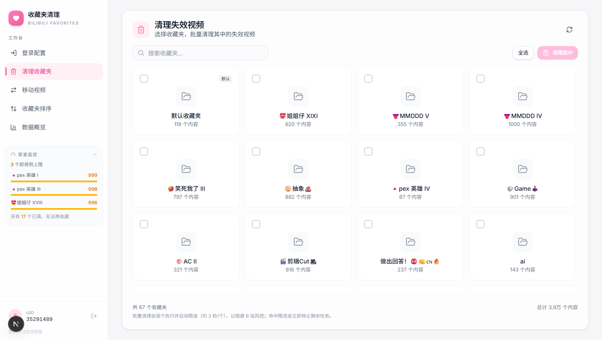
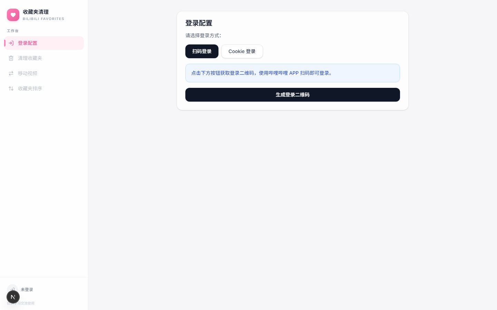
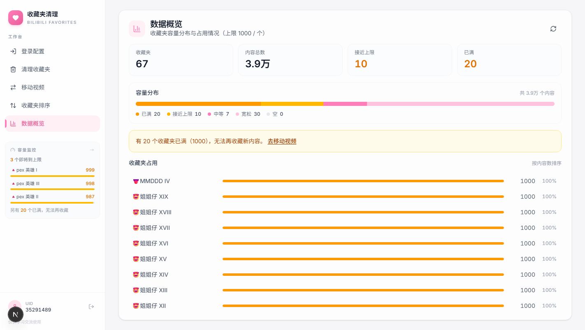
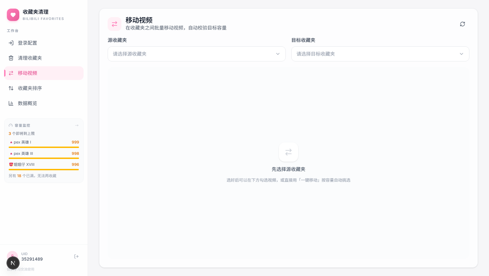

# Bilibili Favorites Cleaner

B 站收藏夹管理工具：批量清理失效视频、跨收藏夹移动视频、拖拽排序、容量分析。



## 功能

- **扫码登录** — 调用 B 站官方二维码接口，Cookie 不经过任何第三方服务
- **Cookie 登录** — 手动粘贴 Cookie 作为备用登录方式
- **清理失效视频** — 批量勾选收藏夹，逐个清理并汇总每个夹清掉的数量
- **移动视频** — 收藏夹之间移动视频，自动校验目标容量；已满（1000）的收藏夹不会出现在目标列表
- **收藏夹排序** — 拖拽调整顺序，默认收藏夹固定第一位
- **数据概览** — 容量分布、占用排行、接近上限与已满的收藏夹统计

## 界面预览

| 登录配置 | 数据概览 |
| :---: | :---: |
|  |  |

| 移动视频 | 收藏夹排序 |
| :---: | :---: |
|  |  |

<p align="center">
  
</p>

## 技术栈

- **Next.js 16** + **React 19** + **TypeScript**
- **Tailwind CSS v4**
- **Zustand** 状态管理
- **Lucide React** 图标
- **qrcode.react** 二维码渲染

## 快速开始

```bash
npm install
npm run dev     # 开发
npm run build   # 构建
npm start       # 生产运行
```

启动后访问 `http://localhost:3000`。

## 使用说明

1. **登录** — 侧栏「登录配置」，扫码或粘贴 Cookie
2. **清理收藏夹** — 勾选收藏夹后点「清理选中」，任务逐个执行，命中限流会立即中止
3. **移动视频** — 选择源与目标收藏夹，勾选视频或直接用「一键移动」按容量自动挑选
4. **收藏夹排序** — 拖拽调整后保存
5. **数据概览** — 查看容量分布、占用排行与风险提示

## 请求限流

B 站对收藏夹相关接口有风控，短时间大量请求会返回 `-509 / -352 / -412`，触发后可能数小时内无法读取收藏夹详情。所有出站请求统一经过 `lib/rate-limit.ts`：

| 机制 | 规则 |
|------|------|
| 串行队列 | 所有请求排队执行，不并发 |
| 最小间隔 | 读 800ms / 写 3000ms |
| 每分钟上限 | 读 45 次 / 写 12 次 |
| 风控退避 | 命中风控码等待 5s、15s 重试，最多 2 次 |
| 熔断 | 重试仍失败则返回 429，前端立即中止剩余批量任务 |

可用环境变量覆盖：`BILI_READ_INTERVAL_MS`、`BILI_WRITE_INTERVAL_MS`、`BILI_READ_MAX_PER_MINUTE`、`BILI_WRITE_MAX_PER_MINUTE`、`BILI_MAX_RETRIES`。

## 项目结构

```
app/
  (app)/           # 页面（共用侧栏布局）
    page.tsx       # 登录
    clean/ move/ sort/ overview/
  api/             # API 路由
    favorites/     # 收藏夹列表与内容
    clean/ move/ sort/
    login/qrcode/  # 扫码登录（申请二维码 / 轮询状态）
  globals.css      # 全局样式与 B 站品牌色
components/
  app-sidebar.tsx  # 侧栏导航 + 容量监控
  login-panel.tsx  clean-panel.tsx  move-panel.tsx  sort-panel.tsx  overview-panel.tsx
  ui/              # Button / Card / Alert / Select 等基础组件
lib/
  bilibili-api.ts  # B 站接口封装
  rate-limit.ts    # 请求节流、退避重试、熔断
  api-error.ts     # 统一错误响应
  utils.ts
store/
  use-app-store.ts # Zustand 全局状态
types/
  index.ts
docs/
  screenshots/          # README 界面截图
  API-Documentation.md  # B 站接口抓包记录
  项目需求分析.md  技术选型.md
```

## 许可

仅供学习交流使用。
